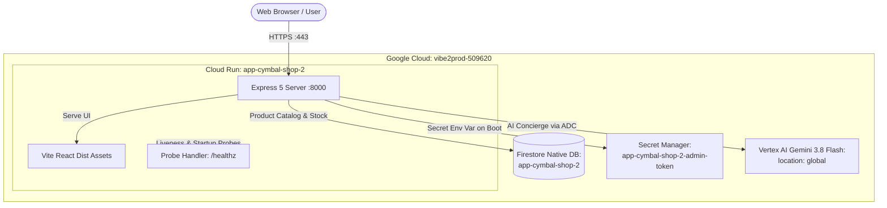

# Cymbal Superstore Production Deployment Architecture

## Context
Cymbal Superstore is an e-commerce grocery and inventory web application adapted from `GoogleCloudPlatform/cymbal-superstore`. It consists of an Express.js backend serving both a Vite React single-page application and RESTful APIs, alongside an AI Shopping Concierge powered by Google's Gemini models.

A previous security hardening phase removed hardcoded credentials, eliminated command injection and path traversal risks, added Helmet security headers, sanitized CORS configurations, and containerized the application as a non-root user. This architecture designs the production deployment on Google Cloud project `vibe2prod-509620` in `us-central1`, migrating ephemeral state to managed services, fixing production CORS validation for Cloud Run domains, and enforcing platform identity and org policy constraints.

## Architecture

The application is hosted entirely on a single Google Cloud Run service (`app-cymbal-shop-2`), serving both static frontend assets and dynamic API endpoints from container port 8000.

- **Compute**: Cloud Run v2 service `app-cymbal-shop-2` configured with public ingress (`INGRESS_TRAFFIC_ALL`) and `invoker_iam_disabled = true` to allow public web access without violating org policies against `allUsers` IAM bindings.
- **Database**: Dedicated Firestore Native database `app-cymbal-shop-2` in `us-central1` to store product inventory durably across stateless container scaling and restarts. The platform's default Firestore database is strictly avoided.
- **Artificial Intelligence**: AI Shopping Concierge calls Gemini model `gemini-3.8-flash` via Vertex AI in location `global` using the `@google/genai` SDK with ambient credentials from the runtime service account, eliminating API key requirements.
- **CORS Handling**: The Express CORS middleware is updated to permit requests from `*.run.app` domains, localhost, and any custom domains specified in `ALLOWED_ORIGINS`, preventing CORS errors on browser POST and DELETE requests.
- **Secrets Management**: Administrative token used for inventory deletion is generated via Terraform `random_password`, stored in Secret Manager (`app-cymbal-shop-2-admin-token`), and exposed to Cloud Run as a secret environment variable `ADMIN_TOKEN`.
- **Health Monitoring**: Startup and liveness probes query a dedicated `/healthz` route, ensuring container stability without triggering database reads or AI inference.

## Data Flow

1. **User Interface Loading**: The client browser issues an HTTPS request to the Cloud Run service URL. Express serves `index.html` and pre-built Vite assets from `/app/dist` alongside static product images from `/app/public/product-images`.
2. **Catalog Browsing**: The React client queries `GET /api/products` or `GET /api/newproducts`. Express queries the `products` collection in Firestore database `app-cymbal-shop-2` and returns serialized JSON to the browser.
3. **Inventory Management**: Authorized administrators submit `POST /api/products` (adding an item) or `DELETE /api/products/:id` with the `x-admin-token` header. The browser sends the Cloud Run origin (`https://app-cymbal-shop-2-...run.app`), which the updated CORS middleware accepts. The server verifies the token against the Secret Manager-injected `ADMIN_TOKEN` using `crypto.timingSafeEqual` and commits the mutation directly to Firestore.
4. **AI Shopping Concierge**: When users submit a shopping goal, the browser posts to `/api/concierge`. Express queries in-stock items from Firestore, formats a basket recommendation prompt, and invokes `ai.models.generateContent` on `gemini-3.8-flash` via Vertex AI using Application Default Credentials (ADC). The generated recipe and item recommendations are returned to the UI.
5. **Health Checks**: Google Cloud Run infrastructure polls `GET /healthz` every 15 seconds. The handler returns immediately with HTTP 200 `{ status: "healthy" }`, incurring zero external API or database overhead.

## Security

- **Authentication & Secret Access**: No secrets or API keys are stored in source code or container images. Administrative tokens are stored in Secret Manager. Cloud Run mounts `ADMIN_TOKEN` as a secret environment variable at runtime.
- **IAM Least Privilege**: Cloud Run runs under the runtime service account `vibe2prod-app-runtime@vibe2prod-509620.iam.gserviceaccount.com`. The account has pre-existing access to `roles/aiplatform.user` for Vertex AI. Secret access is limited strictly to `roles/secretmanager.secretAccessor` on the `app-cymbal-shop-2-admin-token` secret. Firestore access is scoped using a CEL condition to allow operations solely within database `projects/vibe2prod-509620/databases/app-cymbal-shop-2`.
- **Org Policy Compliance**: Organization policy forbids IAM bindings to `allUsers` and `allAuthenticatedUsers`. Public traffic is enabled strictly through Cloud Run native configuration: `ingress = INGRESS_TRAFFIC_ALL` and `invoker_iam_disabled = true`.
- **App & Container Hardening**: The Dockerfile builds from `node:24-slim` and executes as non-root user `1000:1000`. Express implements Helmet with Content Security Policy directives, disables `x-powered-by`, restricts CORS origins to trusted hostnames and `.run.app` service domains, limits JSON payload bodies to 1 MB, and sanitizes user input via `validator.escape`.

## IAM Configuration

| Principal | Role | Resource | CEL Condition | Justification |
| :--- | :--- | :--- | :--- | :--- |
| `serviceAccount:vibe2prod-app-runtime@vibe2prod-509620.iam.gserviceaccount.com` | `roles/datastore.user` | `project` (`vibe2prod-509620`) | `resource.name == "projects/vibe2prod-509620/databases/app-cymbal-shop-2"` | Authorizes document reads and writes strictly within the app's dedicated Firestore database. |
| `serviceAccount:vibe2prod-app-runtime@vibe2prod-509620.iam.gserviceaccount.com` | `roles/secretmanager.secretAccessor` | `app-cymbal-shop-2-admin-token` | None | Allows Cloud Run to read the administrative token value on container initialization. |

*Note: `roles/aiplatform.user` is pre-granted to the runtime service account at the project level and is not modified by this deployment.*

## Configuration

### Environment Variables

| Name | Source | Value / Target | Purpose |
| :--- | :--- | :--- | :--- |
| `NODE_ENV` | Literal | `production` | Enables Express production optimizations. |
| `PORT` | Literal | `8000` | Defines HTTP port matching Dockerfile and Cloud Run container port. |
| `GOOGLE_CLOUD_PROJECT` | Literal | `vibe2prod-509620` | Informs Google GenAI and Firestore SDKs of the target project ID. |
| `FIRESTORE_DATABASE_ID` | Literal | `app-cymbal-shop-2` | Connects Firestore client to the dedicated native database. |
| `ALLOWED_ORIGINS` | Literal | `""` | Optional comma-separated list of additional allowed CORS origins. |
| `ADMIN_TOKEN` | Secret Manager | `app-cymbal-shop-2-admin-token:latest` | Secret token verifying admin access on deletion endpoints. |

### Secrets

| Secret Name | Injected Env Var | Value Source | Purpose |
| :--- | :--- | :--- | :--- |
| `app-cymbal-shop-2-admin-token` | `ADMIN_TOKEN` | Terraform `random_password` (32 chars) | Secures administrative inventory deletion against unauthorized requests. |

## Cost Drivers

Resource consumption is designed for high efficiency and scales to zero when idle:
- **Cloud Run Compute**: Billed per vCPU-second and GiB-second during active request handling. Configured with 1 vCPU, 512 MiB memory, `min_instance_count = 0`, and `max_instance_count = 3`.
- **Firestore Operations**: Driven by document read operations during catalog views and AI prompt construction, with document writes occurring upon item creation or deletion.
- **Vertex AI Gemini 3.8 Flash**: Driven by input and output tokens consumed by the AI Shopping Concierge (estimated at ~350 input tokens and ~150 output tokens per request).
- **Secret Manager**: Minor access operations incurred when new Cloud Run container instances initialize.

## Operations and Observability

- **Health Monitoring**: Dedicated `/healthz` endpoint verified by Cloud Run startup probes (initial delay 2s, period 5s) and liveness probes (period 15s). Containers failing probes are automatically replaced.
- **Logging**: Express request errors, Firestore connection states, and Vertex AI inference issues are logged to standard output/error, ingested automatically by Google Cloud Logging under resource type `cloud_run_revision`.
- **Alerting Recommendation**: It is recommended to configure a project-level Cloud Monitoring budget alert notification at standard thresholds (50%, 80%, 100%) targeting the team's operational notification channel via Cloud Console.

## Rollout Plan

1. **Database & Secrets Provisioning**: Apply Terraform to provision `google_firestore_database.app-cymbal-shop-2`, `random_password`, and Secret Manager secret with version.
2. **IAM Entitlements**: Apply scoped `roles/datastore.user` and `roles/secretmanager.secretAccessor` bindings for the runtime service account.
3. **Application Build & Deployment**: Build the container image with `@google-cloud/firestore` dependencies and updated code; deploy to `google_cloud_run_v2_service.app-cymbal-shop-2`.
4. **Database Seeding**: Upon initial container startup, the application queries Firestore and automatically seeds the default grocery items if the `products` collection is empty.
5. **Verification**: Verify `/healthz` returns 200, test catalog loading on `/api/products`, submit a sample AI query on `/api/concierge`, and verify admin deletion with the injected secret.

## Risks

- **Ephemeral Local Storage**: Uploaded files via `/api/upload` write to the local `/app/uploads` container directory. In Cloud Run, container filesystems are ephemeral and memory-backed; uploads do not persist across instance scaling or restarts. Because the storefront UI exclusively references static images compiled under `/product-images/`, this behavior is acceptable and avoids maintaining an external Cloud Storage bucket.
- **Debian Slim CLI Utilities**: The slim Node container base image does not include the system `zip` binary, meaning `/api/export` will trigger a command error if called. This endpoint is an unlinked test artifact and does not affect storefront shopping.
- **Vertex AI Global Availability**: AI concierge inference calls the global endpoint. Transient network anomalies or API quotas will cause the endpoint to catch errors gracefully, returning user-friendly error notices without crashing the service.

## Required Code Changes

1. **Add Health Check Route (`server.js`)**:
   Add an Express route for `/healthz` returning status code 200 with `{ status: "healthy" }` to satisfy Cloud Run probes.
2. **Allow Cloud Run CORS Origins (`server.js`)**:
   Update the CORS origin validation callback to allow origins where `originUrl.hostname.endsWith('.run.app')`, `originUrl.hostname === 'localhost'`, `originUrl.hostname === '127.0.0.1'`, or included in `process.env.ALLOWED_ORIGINS`.
3. **Vertex AI Migration (`server.js`)**:
   Update `getAiClient()` to instantiate `GoogleGenAI` with `{ vertexai: true, project: process.env.GOOGLE_CLOUD_PROJECT || "vibe2prod-509620", location: "global" }` using ambient service account credentials. Remove the `GEMINI_API_KEY` check from `/api/concierge`.
4. **Add Firestore Dependency (`package.json`)**:
   Add `"@google-cloud/firestore": "^7.11.0"` to application dependencies.
5. **Firestore Inventory Persistence (`server.js`)**:
   Import Firestore and initialize a database connection to `process.env.FIRESTORE_DATABASE_ID || "app-cymbal-shop-2"`. Replace the in-memory `products` array with Firestore collection reads, writes, and deletes across `/api/products`, `/api/newproducts`, `/api/products/:id`, `/search`, and `/api/concierge`. Include an automatic seed routine that populates default catalog items if the database is initially empty.

---
Written by the Vibe2Prod Architect agent; independent critic approved after 2 round(s). A human approves before Terraform is written.
