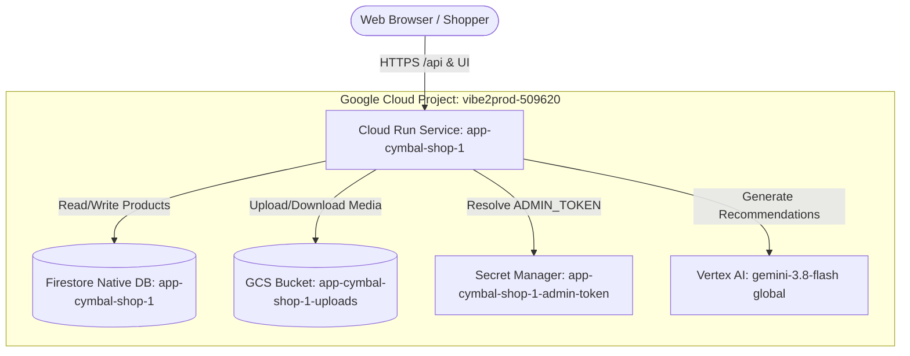

# Production Infrastructure Design Doc: Cymbal Superstore (app-cymbal-shop-1)

## Context
Cymbal Superstore is an e-commerce grocery and inventory demonstration application composed of a Vite React frontend and an Express 5 backend. The application provides catalog browsing, product filtering (all vs new arrivals), inventory creation and administrative deletion, image upload and zip export, and an AI-powered Shopping Concierge backed by Gemini.

In its prototype form, the application maintained catalog state in an in-memory JavaScript array, stored uploads on the local container filesystem, and depended on a client-managed Gemini API key. Furthermore, CORS handling was restricted strictly to localhost origins, which causes browser fetch requests on Cloud Run to fail with 500 errors. This design transitions Cymbal Superstore to an enterprise production deployment on Google Cloud project `vibe2prod-509620` in `us-central1`, satisfying all platform governance rules, non-root execution, ephemeral filesystem statelessness, dynamic same-origin CORS negotiation, and IAM-authenticated Vertex AI integration.

---

## Architecture

The application runs as a single Cloud Run service (`app-cymbal-shop-1`) deployed from the application Dockerfile. The container serves static React assets compiled by Vite along with Express API routes on port 8000. All state is externalized to managed GCP services:
- **Firestore Native Database (`app-cymbal-shop-1`)**: Houses catalog product documents and inventory numbers.
- **Cloud Storage Bucket (`app-cymbal-shop-1-uploads`)**: Stores uploaded product imagery and supplies files for zip archive exports.
- **Secret Manager (`app-cymbal-shop-1-admin-token`)**: Holds the administrative token for privileged deletion operations.
- **Vertex AI (`gemini-3.8-flash`)**: Powers the Cymbal AI Shopping Concierge via Application Default Credentials (ADC).

---

## Data Flow

1. **Browsing Catalog (`GET /api/products`, `GET /api/newproducts`)**:
   - Shopper navigates to the store.
   - Express handles the request and queries the `products` collection in Firestore database `app-cymbal-shop-1`.
   - If the database is empty (first deployment), Express automatically seeds the 9 initial catalog items idempotently.
   - JSON product arrays are returned and rendered in React.

2. **Inventory Modification (`POST /api/products`, `DELETE /api/products/:id`)**:
   - Express validates CORS dynamically by verifying that the request `Origin` matches the incoming `Host` header (`req.headers.host`) or matches configured `ALLOWED_ORIGINS`.
   - New items submitted via the UI form are validated and written as documents in Firestore with generated IDs and timestamps.
   - Deletion requests require the `x-admin-token` header matching `ADMIN_TOKEN` mounted from Secret Manager before deleting the target document from Firestore.

3. **Product Media Management (`POST /api/upload`, `GET /api/files/:filename`, `GET /api/export`)**:
   - Images uploaded via `/api/upload` are processed in-memory by Multer and written directly to `app-cymbal-shop-1-uploads`.
   - Images requested via `/api/files/:filename` are streamed from the GCS bucket.
   - Inventory exports (`/api/export`) fetch the files from Cloud Storage, compress them using `/usr/bin/zip` into `/tmp`, stream the archive to the client, and clean up temporary storage.

4. **Shopping Concierge (`POST /api/concierge`)**:
   - Shopper submits a goal (e.g., "Quick healthy weeknight snacks under $25").
   - Express queries the Firestore `products` collection directly for items with `quantity > 0` to construct the active stock list.
   - Express calls `@google/genai` in `vertexai: true` mode targeting `gemini-3.8-flash` in location `global` using the platform service account.
   - The assistant response is returned as JSON to the UI panel.

5. **Health Checks (`GET /api/health`)**:
   - Cloud Run startup and liveness probes hit `/api/health`.
   - The endpoint immediately returns `200 OK` (`{ status: "ok" }`) without external calls.

---

## Security

- **Container Isolation**: Dockerfile executes as unprivileged user `1000:1000` with read-only application files.
- **Network Ingress & Public Access**: Ingress is set to `INGRESS_TRAFFIC_ALL` with `invoker_iam_disabled = true`. No IAM binding to `allUsers` is created, complying with organization policies.
- **IAM Scoping**: The shared runtime identity `vibe2prod-app-runtime@vibe2prod-509620.iam.gserviceaccount.com` has zero administrative roles. Cloud Storage roles (`roles/storage.objectViewer` and `roles/storage.objectCreator`) and Secret Manager role (`roles/secretmanager.secretAccessor`) are assigned directly to the individual resources. Firestore access is scoped via a CEL condition to `app-cymbal-shop-1`.
- **Secret Protection**: Administrative token `ADMIN_TOKEN` is generated dynamically using Terraform `random_password`, written to Secret Manager, and injected as a secret-backed environment variable. No secrets are stored in code or repository configuration.
- **Storage Controls**: Cloud Storage bucket `app-cymbal-shop-1-uploads` enforces `uniform_bucket_level_access` and `public_access_prevention = "enforced"`.
- **CORS Protection**: The CORS middleware dynamically allows requests originating from the service's own Host domain or specified allowed origins, preventing cross-origin exploitation while allowing legitimate web UI interaction.
- **Web Security**: Helmet HTTP headers (CSP, frameguard, no-sniff) are enforced in `server.js`.

---

## IAM

| Principal | Role | Resource | Condition | Purpose |
|---|---|---|---|---|
| `serviceAccount:vibe2prod-app-runtime@vibe2prod-509620.iam.gserviceaccount.com` | `roles/datastore.user` | `projects/vibe2prod-509620` | `resource.name == "projects/vibe2prod-509620/databases/app-cymbal-shop-1"` | Scoped read/write access to Firestore catalog database |
| `serviceAccount:vibe2prod-app-runtime@vibe2prod-509620.iam.gserviceaccount.com` | `roles/storage.objectViewer` | `app-cymbal-shop-1-uploads` | None | Object read and list on product media bucket |
| `serviceAccount:vibe2prod-app-runtime@vibe2prod-509620.iam.gserviceaccount.com` | `roles/storage.objectCreator` | `app-cymbal-shop-1-uploads` | None | Object upload/creation on product media bucket |
| `serviceAccount:vibe2prod-app-runtime@vibe2prod-509620.iam.gserviceaccount.com` | `roles/secretmanager.secretAccessor` | `app-cymbal-shop-1-admin-token` | None | Container access to read the administrative token value |

*Note: The platform service account already possesses `roles/aiplatform.user` at project level for Vertex AI API operations.*

---

## Configuration (Env Vars and Secrets)

| Variable Name | Source | Value / Target | Purpose |
|---|---|---|---|
| `PORT` | Literal | `8000` | HTTP port on which Express listens |
| `NODE_ENV` | Literal | `production` | Enables production optimizations in Express |
| `GOOGLE_CLOUD_PROJECT` | Literal | `vibe2prod-509620` | Project ID for Vertex AI and SDK initializations |
| `FIRESTORE_DATABASE_ID` | Literal | `app-cymbal-shop-1` | Target Firestore Native database ID |
| `GCS_BUCKET_NAME` | Literal | `app-cymbal-shop-1-uploads` | Target GCS bucket for media uploads |
| `VERTEX_AI_LOCATION` | Literal | `global` | Location for Vertex AI Gemini model calls |
| `GEMINI_MODEL` | Literal | `gemini-3.8-flash` | Gemini model identifier |
| `ADMIN_TOKEN` | Secret | `app-cymbal-shop-1-admin-token:latest` | Bearer token for authenticating admin deletion |

---

## Cost Drivers

Resource costs are governed strictly by usage quantities with no fixed overhead:
- **Cloud Run Compute**: Sized at 1 vCPU and 512MiB RAM with `min_instance_count = 0`. Compute scales to zero during idle periods and scales up to a maximum of 3 instances during traffic bursts.
- **Firestore Operations**: Document reads and writes for product catalog browsing, updates, and concierge catalog fetching (~10,000 reads and ~100 writes per month).
- **Cloud Storage**: Object storage volume (~1.0 GB) for media assets and operations (250 Class A writes/lists, 2,500 Class B reads).
- **Vertex AI Invocations**: 500 concierge generation calls per month with an average prompt length of 600 input tokens and 250 response tokens on `gemini-3.8-flash`.
- **Secret Manager**: Version access calls (~300/month) executed exclusively during container startup.

---

## Operations and Observability

- **Health Probing**: Startup probe runs every 5 seconds (up to 30s) hitting `/api/health`. Liveness probe checks `/api/health` every 15 seconds. Failed liveness checks cause Cloud Run to restart the container automatically.
- **Logging**: Express console logs, errors, and unhandled rejections are structured to standard output and automatically captured by Cloud Logging.
- **Monitoring**: Cloud Run request latency, concurrency, and 4xx/5xx status code metrics are available natively in Cloud Monitoring.
- **Budget Recommendation**: An alert threshold rule is recommended in Cloud Console billing settings at operational project boundaries to notify engineering when monthly spend approaches target budgets.

---

## Rollout

1. Terraform provisions the Firestore Native database `app-cymbal-shop-1` in `us-central1`.
2. Terraform provisions Cloud Storage bucket `app-cymbal-shop-1-uploads` with uniform access and labels.
3. Terraform generates random password `app-cymbal-shop-1-admin-token-pass` and stores it in Secret Manager secret `app-cymbal-shop-1-admin-token`.
4. Terraform assigns scoped IAM roles on the bucket (`roles/storage.objectViewer` and `roles/storage.objectCreator`), secret, and Firestore condition to the platform service account.
5. Container image is built with applied code changes and pushed to Artifact Registry.
6. Terraform deploys `google_cloud_run_v2_service` (`app-cymbal-shop-1`) with secret and environment bindings.
7. On initial startup, startup probe verifies `/api/health` and Cloud Run marks the revision healthy.

---

## Risks

1. **Cold Starts**: With `min_instance_count = 0`, container cold starts may introduce a 1 to 3 second delay on the first user request after an idle period.
2. **Export Processing Load**: Large export requests on `/api/export` utilize CPU and memory during zip compression; max concurrency of 80 mitigates single-instance starvation, while max instances (3) bounds resource usage.
3. **Seeding Concurrency**: If multiple instances start simultaneously against an uninitialized database, both may attempt initial catalog seeding. The code change implements idempotent document ID assignment (`doc(String(product.id)).set(...)`) to prevent duplicate records.
4. **Model Availability**: The concierge depends on `gemini-3.8-flash` global Vertex AI endpoint availability; fallback error handling in the API returns structured error responses to the UI.

---

## Required Code Changes

1. **`package.json`**:
   - Add `@google-cloud/firestore` (`^7.11.0`) and `@google-cloud/storage` (`^7.15.0`) to dependencies.
2. **`server.js` (Health Check)**:
   - Implement `app.get("/api/health", (req, res) => res.status(200).json({ status: "ok" }))` for probe endpoints.
3. **`server.js` (CORS Middleware)**:
   - Update the CORS middleware to dynamically validate whether the `Origin` header matches `http://${req.headers.host}` or `https://${req.headers.host}`, or is included in `allowedOrigins`, or is absent (same-origin / server-to-server).
4. **`server.js` (Firestore Catalog)**:
   - Import `Firestore` from `@google-cloud/firestore` configured with `databaseId: process.env.FIRESTORE_DATABASE_ID || "app-cymbal-shop-1"` and `projectId: process.env.GOOGLE_CLOUD_PROJECT || "vibe2prod-509620"`.
   - Replace in-memory `products` array with Firestore operations on the `products` collection across `GET /api/products`, `GET /api/newproducts`, `POST /api/products`, and `DELETE /api/products/:id`.
   - Include initial idempotent seed population if `products` collection contains zero documents.
5. **`server.js` (Cloud Storage Uploads & Export)**:
   - Import `Storage` from `@google-cloud/storage` pointing to `process.env.GCS_BUCKET_NAME || "app-cymbal-shop-1-uploads"`.
   - Switch Multer from disk storage to `multer.memoryStorage()`.
   - Save uploaded file buffers directly to GCS in `POST /api/upload`.
   - Stream objects from GCS in `GET /api/files/:filename`.
   - Download GCS objects to `/tmp/uploads` before creating the archive in `GET /api/export`.
6. **`server.js` (Vertex AI Shopping Concierge & Inventory Lookup)**:
   - Update `POST /api/concierge` to query current in-stock products (`quantity > 0`) directly from the Firestore `products` collection rather than an in-memory array.
   - Remove dependency on `process.env.GEMINI_API_KEY`.
   - Initialize `GoogleGenAI` with `{ vertexai: true, project: process.env.GOOGLE_CLOUD_PROJECT || "vibe2prod-509620", location: process.env.VERTEX_AI_LOCATION || "global" }`.
   - Execute shopping recommendations targeting model `gemini-3.8-flash`.

---
Written by the Vibe2Prod Architect agent; independent critic approved after 3 round(s). A human approves before Terraform is written.
